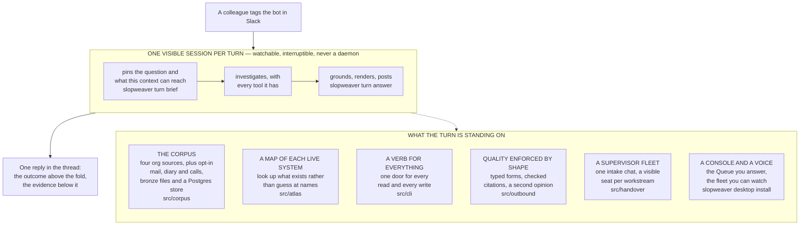

# Architecture

How Slopweaver turns your team's recent history into a queryable, on-device world model — and how it acts on
what it learns. What leaves the machine: the source reads you authorise, the visible agent-session calls you
already make, the Slack messages and other provider writes you send, a one-token probe of each Claude plan's
budget to Anthropic, and three opt-in paths — the prompts and diffs the `codex` verbs send to OpenAI, what the
console voice (`talk`) sends to OpenAI, and the account listing and chats `chatgpt list`, `chatgpt live-sync` and
`chatgpt conversation` read back from ChatGPT. The store is never among them: it is a local database, and a URL naming
another host is refused with no escape hatch. Nor is `store backup`: it writes encrypted objects into a local
directory you configure. See
[security/data-flow.md](security/data-flow.md#data-flow) for the full flow.

**The corpus is a rolling window, not an archive.** `refresh` pulls a bounded backfill — 90 days by default
for Slack, Linear and Notion, 7 for GitHub, which resumes from a per-repo cursor — and each run extends it
forward from a watermark. Every stage downstream inherits that: silver derives over the window, gold distils
the window, and retrieval can only cite what the window holds. Widening it is a per-run flag
(`--lookback-days`, `--since`, `--all`), not an assumption anything here makes.

Design constraints — what is fixed, what is deliberately relaxed, and what only looks fixed — are recorded
separately in [constraints.md](constraints.md). Read that before proposing a change to any of the shapes below.

## The pieces

- [Shape and stages](architecture/shape-and-stages.md) — the plugin's shape, the atom, and the stages from bronze to gold.
- [Atlases](architecture/atlases.md) — the map of each live system.
- [Writing back out](architecture/writing-back-out.md) — how an answer or a write leaves.
- [Claude plan rotation](architecture/claude-plan-rotation.md), continued in
  [the active plan and its accounts](architecture/claude-plan-rotation-active-plan.md).
- [The Codex brain, transports and trust](architecture/trust-and-transports.md).
- [Packaging and layout](architecture/packaging-and-layout.md) — what ships, and where each module lives.

## Diagrams

Nine pictures, each authored once under [docs/diagrams/](diagrams/) as a Mermaid `.mmd` and drawn on exactly
one page: the overview [below](#one-page), the voice flow in [voice-flow.md](voice-flow.md), and the seven
after it, one page each.
They are drawn from the code rather than from memory, and **every module path or verb a box names is
real**, so a reader can jump from that box to the file behind it. That is also what keeps them honest: a unit
test (`src/__tests__/unit/canon/diagramReferences.test.ts`) resolves every `src/…` path against the
filesystem and every `slopweaver …` label against the live CLI manifest, and asserts each fence is its
source file byte for byte. A box naming a path or verb that does not exist fails the build; whether an
edge is true is checked by reading the code it names.

Read them in the order a colleague asks: what is this, how does a question get in, how does an answer get
out, who is driving all this, what does a run over one workstream look like, where does the evidence come
from, what can it do, and what leaves the machine.

1. [One page](#one-page) — the several things going on at once.
2. [Inbound — a tag becoming an answer](architecture/inbound.md)
3. [Outbound — what can post, and under which token](architecture/outbound.md)
4. [The supervisor loop](architecture/supervisor-loop.md)
5. [The run lifecycle](architecture/run-lifecycle.md)
6. [The corpus](architecture/corpus.md)
7. [The verb surface](architecture/verb-surface.md)
8. [Trust boundaries](architecture/trust-boundaries.md)

## One page

One Slack turn, and what it stands on. A tag in Slack is one way in: the desktop app, a Claude Code session and a
voice call reach the same fleet, and the boxes under the turn are what every one of them stands on.

