# 2 · Inbound — a tag becoming an answer

Part of [Architecture](../architecture.md).

Capture, what the asker already has in flight, the tier the visible session judges, the card a dispatch
finds or posts before any worker starts, and the checks in front of the send. Note where the model does and does
not run: nowhere on the listener's side of this picture.

```mermaid
flowchart TB
  subgraph capture["Capture — no model runs yet"]
    direction LR
    msg["An explicit tag — an app_mention in a channel,<br/>or a tagged message.im in a 1:1 DM — or a reply<br/>under one of the bot's own posts, in an opted-in channel"]
    sock["one outbound websocket, nothing inbound<br/>slopweaver listen run · src/live/listen/socket.ts"]
    who{"On responders.json? Re-read on every<br/>tag inside the listener's scope.<br/>an open responder-allow-open<br/>grant admits anyone, here and at the send<br/>src/live/listen/whitelist.ts"}
    cap["CAPTURE: reaction, then a checklist,<br/>before any turn exists<br/>src/live/listen/capture.ts"]

    msg --> sock --> who
    who -->|"yes"| cap
  end

  refuse["A fixed wait line, tagging the<br/>owner in when their Slack id is valid.<br/>Never silence, never a turn<br/>(the break-glass skips this)"]
  who -->|"no"| refuse

  subgraph witness["Witness — a thread that tags a PEER bot, or tagged this one, under --follow only"]
    direction LR
    wtap["A witness line: no reaction, no card,<br/>14-day watch, 40 lines a thread a day<br/>src/live/listen/witnessTap.ts"]
    wjudge{"A claim to check, or, in the<br/>bot's own thread, a need it can meet?"}
    wsettle["Settled silent<br/>witness settle --as nothing-checkable"]
    wwork["One visible worker checks every source<br/>witness dispatch · src/live/witness/session.ts"]
    wpost["Material, with proof: ONE witness form<br/>src/outbound/artifact/witness.ts.<br/>Otherwise silent, with its why"]
    whelp["Help unprompted: journal helped, then<br/>the SAME capture as a tag<br/>witness help · src/live/witness/help.ts"]
    wstand["Told it is in the way: a reaction, never a reply;<br/>the thread is witnessed no further<br/>witness stand-down · src/live/witness/standDown.ts"]
    wtap --> wjudge
    wjudge -->|"no"| wsettle
    wjudge -->|"a claim"| wwork --> wpost
    wjudge -->|"a need, own thread"| whelp
    wjudge -->|"go away"| wstand
  end
  sock -.->|"a watched thread"| wtap
  whelp -.->|"as if tagged, unprompted: true"| cap

  life[("The ask lifecycle — append-only,<br/>folded on read<br/>src/live/ask/lifecycle.ts")]
  cap --> life

  inflight["What this asker already has in flight,<br/>named in the brief for the judge<br/>src/live/ask/burst.ts"]
  cap --> inflight

  brief["The question, plus what this context<br/>can reach. No model, no door, no route<br/>slopweaver turn brief · src/live/turn/brief.ts"]
  inflight --> brief

  judge{"How much does it need?<br/>src/live/turn/judgement.ts"}
  brief --> judge

  card["Find the card on record or post one,<br/>then try to move it on; a refused update is<br/>reported, not fatal. A failed post stops the dispatch.<br/>A sub-ask with no card on record rides<br/>its parent's card when that card is in the same thread<br/>slopweaver turn dispatch · src/cli/commands/turn/ensureCard.ts"]
  judge -->|"respond"| card

  subgraph tier["Run the tier it judged"]
    direction LR
    inline["inline — answer here"]
    suba["a read-only subagent<br/>src/live/turn/subagent.ts"]
    fresh["a fresh visible session, leased<br/>src/live/turn/tier.ts"]
  end
  card --> inline
  card --> suba
  card --> fresh

  work["Investigate with every tool it has. Advance<br/>the card in place. Compose a typed form<br/>src/outbound/assistant/answerForm.ts"]
  inline --> work
  suba --> work
  fresh --> work

  satisfied["The worker judges another answer covers it:<br/>reap its cards, except one another open<br/>ask may still share; post nothing new.<br/>The verb does not check that answer<br/>slopweaver turn satisfied"]
  work -->|"covered elsewhere"| satisfied
  satisfied --> life

  subgraph gate["Review, then admit"]
    direction LR
    pre{"The door's deterministic gates,<br/>voice rules first — before any reviewer<br/>src/live/turn/answerPreflight.ts"}
    rev["A DIFFERENT session reviews it. The verdict<br/>binds to a digest of the answer's bytes<br/>slopweaver turn review · src/admit/reviewVerdict.ts"]
    send{"Would Slack's wire guard<br/>accept the rendered payload?<br/>src/live/turn/answerSendable.ts"}
    ent{"Asker still on responders.json?<br/>turn answer refuses outright if not.<br/>No owner carve-out<br/>src/cli/commands/turn/postAnswer.ts"}
    wh{"The door's withhold:<br/>that same list, checked again<br/>src/admit/withhold.ts"}
    qg{"Verdict bound, not self-issued, and<br/>the deterministic gates pass again?<br/>src/admit/answerQualityGate.ts"}

    pre -->|"clean"| rev --> ent
    ent -->|"yes"| send
    send -->|"yes"| wh
    wh -->|"on it"| qg
  end
  work --> pre

  fix["Refused, nothing sent. The same<br/>worker corrects it and offers again"]
  pre -->|"a finding"| fix
  send -->|"no"| fix
  qg -->|"a warn"| fix
  fix --> work

  outright["Refused outright, nothing sent"]
  ent -->|"no"| outright

  held["HELD, with the draft and the reason<br/>slopweaver queue release · src/admit/queue.ts"]
  post["Post the cited card through the door, then<br/>delete the working message — kept if another<br/>open ask may still share it<br/>slopweaver turn answer · src/live/turn/poster.ts"]
  wh -->|"withheld at the door"| held

  waive["Every door warn, the withhold included,<br/>is waived per action by its token in<br/>SLOPWEAVER_DOOR_OVERRIDE; the door records it<br/>src/admit/door.ts"]
  wh -.- waive
  qg -.- waive
  qg -->|"admitted"| post
  post --> life

  supersede["A declared correction the reviewer warranted,<br/>still eligible, deletes the answer it replaces<br/>src/live/turn/supersession/"]
  post -.->|"supersedes set"| supersede
```

