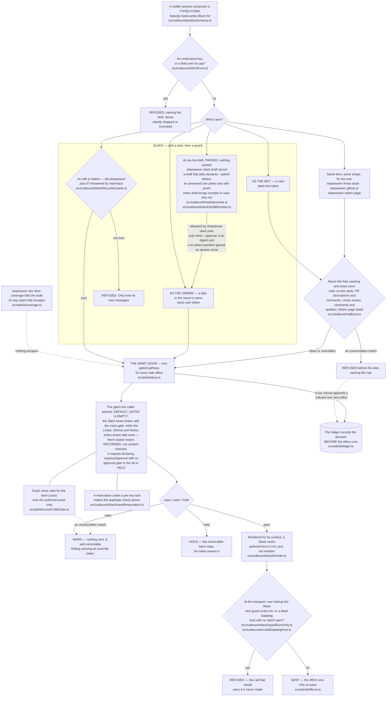

# 3 · Outbound — what can post, and under which token

Part of [Architecture](../architecture.md).

The typed form, the above-the-fold gate before the door, the voice gate the Slack prose lanes pass at the
door, and the three things the door can answer. The door is drawn at its weakest on purpose: for the Linear,
GitHub and Notion writes drawn, routed means recorded, not content-checked at the door; their checks run before it,
and the outbound privacy check and the dead-host refusal run at each one's write transport after it. A Gmail write
(`gmail draft`, `send`, `label`, `unsubscribe`, not drawn) runs the same two in the Gmail auth client's `fetch`,
strict, a send judged on the draft Gmail holds ([write transports](../security/write-transports.md)).

