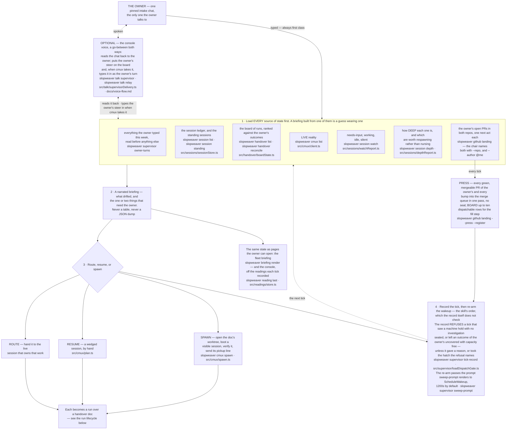

# 4 · The supervisor loop

Part of [Architecture](../architecture.md).

One intake chat, every source of state loaded before it speaks, three things it can do with an instruction, and a
tick its skill has the chair re-arm every time.

**The console voice is the one optional box above.** How a spoken steer becomes a board row and a turn
typed into this chat, what the chair owes it the same tick, and how the answer gets back is its own page and
picture: [voice-flow.md](../voice-flow.md).

**What the fleet did, read from its own transcripts.** The state sources above describe sessions that
are LIVE. What each one was actually told, and how much of its traffic was a person rather than the harness
talking to itself, lives only in the Claude session transcripts under `~/.claude/projects`, and
`slopweaver transcripts` is the typed way in:

| Verb                     | What it answers                                                                                                                   |
| ------------------------ | --------------------------------------------------------------------------------------------------------------------------------- |
| `transcripts sessions`   | every transcript on this machine, newest first, with the measured retention floor                                                 |
| `transcripts turns`      | the turns a PERSON took — every tool result, reminder, wrapper, notification and injected skill body stripped                     |
| `transcripts summary`    | turn counts by role, the autonomy ratio, the tool-error count and the span                                                        |
| `transcripts errors`     | every tool call that came back an error, named with the tool that made it                                                         |
| `transcripts latency`    | how long each tool call took, bucketed by hour and split before/after an instant                                                  |
| `transcripts last-turn`  | one session's latest turn as ordered parts — the words that opened it, then text, thinking and tool calls joined to their results |
| `transcripts boot-hooks` | every `SessionStart` hook a transcript records as never run — a missing command or `hook.sh` target — exiting 1 on any            |
| `transcripts draw`       | what each verb cost in MEASURED tokens per tick, added and carried, and every cap refusal retried with the API calls its lap took |

Four properties are load-bearing rather than incidental, and each is a rail rather than a convention:

- **Structured access only. There is no search verb, and there never will be.** A lexical sweep over this
  corpus counts MENTIONS, and a sweeping session's own output is echoed back into its own transcript, so its
  top hits are its own words. Every verb asks about roles, counts and `tool_result.is_error` instead —
  properties of the record rather than of its prose.
- **The retention bound is in the verb's own output.** Claude Code deletes old transcripts, so "nothing
  found" over an aged-out window means the evidence was deleted rather than that nothing happened. Every
  invocation measures the oldest transcript on disk and says whether the requested window falls inside it.
- **A latency question is asked of a HOMOGENEOUS slice, or not at all.** `Bash` is not one tool — `git status`
  and a ten-minute test run share its name — so `transcripts latency` carries `--tool` and `--command-prefix`,
  and every sample says whether it shared an assistant record with others (a parallel batch measures queueing,
  not the tool). Its window bounds the SAMPLES as well as the files, because a transcript written an hour ago
  may hold calls from last week.
- **Nothing is loaded whole.** Transcripts reach tens of megabytes; the walker reads a file in fixed slices
  and yields one decoded line at a time, so what is resident is one chunk regardless of the file's size. A
  session's transcript is located by SEARCHING the project directories for the file named after it, never by
  reconstructing the mangled-directory path — a wrong guess there fails silently, which reads as a session
  nobody recorded rather than as a bug.
