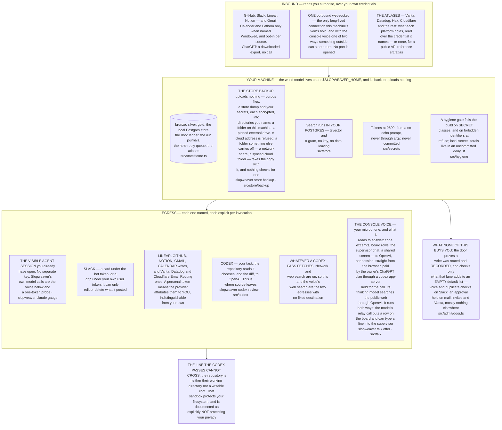

# 8 · Trust boundaries

Part of [Architecture](../architecture.md).

What lives on the machine, what comes in, and every egress named one by one — including the two OpenAI
boundaries, Codex and the console voice, that can carry your source code, and the two with no fixed
destination at all: what a Codex pass fetches, and what the voice's thinking model searches for.

