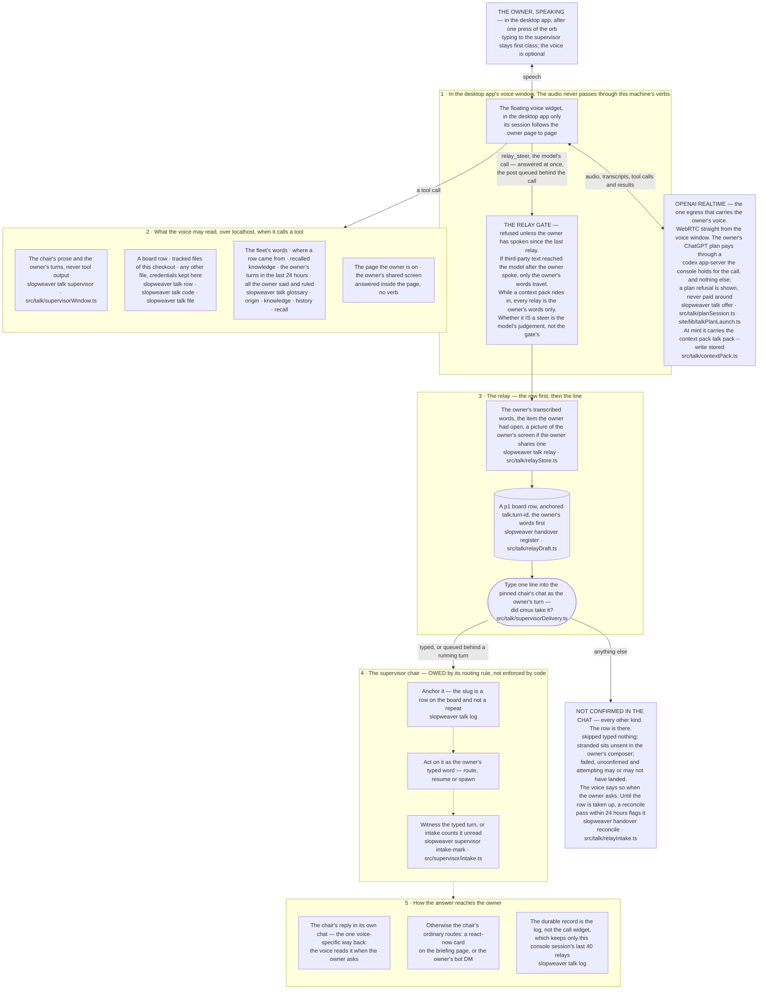

# The voice flow — how a spoken steer reaches the supervisor

The console voice is a go-between, both ways: it reads the supervisor's conversation back to the owner, and when the owner
settles on a steer it puts that steer on the board and, when cmux takes the line, types it into the supervisor's
chat **as the owner's turn**. Typing to the supervisor directly stays first class; the voice is optional and nothing depends on it. A
steer the owner types in the call's chat, the console's one text input, relays exactly as a spoken one; `talk
relay --typed` joins at the verb with no gate and no reading, and no console page calls it. This page is the flow end to end — where each hop lives, what the chair owes it, how an answer gets back, and what
is not built. The egress half (what goes to OpenAI and why) is stated in full in
[security/voice-boundary.md § The console-voice boundary](security/voice-boundary.md#the-console-voice-boundary-slopweaver-talk), and the console
page itself in `site/content/console/call-widget.mdx`; this page does not repeat either.

## Where each part stands

| Part                                                                                                                                                                                                                                                                                                                                                                                      | Where it is |
| ----------------------------------------------------------------------------------------------------------------------------------------------------------------------------------------------------------------------------------------------------------------------------------------------------------------------------------------------------------------------------------------- | ----------- |
| The Talk tab, the `talk` noun and its read verbs                                                                                                                                                                                                                                                                                                                                          | main        |
| The floating widget in the desktop app, on OpenAI's GPT-Live SDK, with the relay gate                                                                                                                                                                                                                                                                                                     | main        |
| `read_screen`, `read_supervisor`, and the relay typed into the chair as the owner's turn                                                                                                                                                                                                                                                                                                  | main        |
| The unprompted relay carrying the owner's transcribed words and a picture of the owner's screen                                                                                                                                                                                                                                                                                           | main        |
| The cmux capability token, so a console the launchd reparented can still reach the chair; the voice saying "on the board, not in the chat" unless cmux took the line; `handover reconcile` flagging relays from the last 24 hours that never reached the chat, five by name and the rest counted; `supervisor intake-mark --turn talk:<turnId>`; `talk log` showing each relay's delivery | main        |
| The data channel limited to the events the console sends; mute that keeps the call up; a hang-up that waits for the session's final usage when it can ask for it                                                                                                                                                                                                                          | main        |
| `glossary`, `origin`, `knowledge` and `supervisor_history`, and both prompts naming every tool                                                                                                                                                                                                                                                                                            | main        |
| The context pack carried into the delegated instructions at mint, and every relay the owner's words only while it rides                                                                                                                                                                                                                                                                   | main        |

Everything below describes main.

In the picture, a **solid arrow is code** and a **dashed arrow is an obligation** — the chair's steps are owed by
its routing rule and checked after the fact by intake, never performed by a verb.

## The picture

## 1 · The session, and where the OpenAI boundary sits

The owner presses the desktop app's orb, the one floating widget: a browser tab draws none and starts no call. The voice's
window makes a WebRTC offer, and **the owner's ChatGPT plan pays, and nothing else does** (the owner's ruling): `talk offer
--voice <voice>` composes a `codex app-server` launch, the console holds that child for exactly the call (`site/lib/talkPlanLaunch.ts`), checks
`account/read` names a ChatGPT login, and opens `thread/realtime/start` at protocol v3 with the offer — the path
Codex CLI's own `/voice` takes. Tools come back as `item/tool/call` over an NDJSON stream
(`/api/talk/call/<id>/events`), are claimed on `/claim` before the page runs one (a settled one is dropped, never
run) and are answered on `/answer`; hang-up posts `/stop`, the owner's nudge `/nudge`, an unanswered silence `/resume` ([why](console/walk-silences.md#the-page-resumes-an-unanswered-steer)), a Slack send's outcome `/send-outcome`, and every 30 s the page asks `/meeting-due` whether a meeting of the owner's is starting, which the voice then names once and whose join link sits beside the orb until the owner clicks it, dismisses it or the meeting ends, bar one the owner said they have had or will not go to ([why](console/voice-notices-meetings.md)), with an Open briefing link beside it when a published page is tagged to that meeting, and `/drift` once the owner has stayed past the dwell in an application off the plan the owner stated, which the voice names once ([why](console/voice-notices-drift.md)), and `/iso-nudge` once the owner has been off ISO in work hours past the dwell with an ISO card waiting, which the voice names once and once more much later ([why](console/voice-nudges-iso.md)). The same stream carries
the Codex thread's turns starting, moving and ending, so the orb shows the work a hand-off became, and a `progress` event while one runs on with the voice silent, which the page plays as its working sound rather than any words ([why](console/walk-silences.md#every-hand-off-says-it-is-on-it-and-a-long-one-plays-that-it-is-still-going)). A plan that refuses is a refusal the call widget shows in its
own words — no platform.openai key, model or voice is tried (`site/lib/talkOffer.ts`).
From then on **the audio and the data channel run directly between the voice window and OpenAI** — no slopweaver
process sees the audio. That is the boundary: everything the model hears and every tool result the page returns
crosses to OpenAI, and nothing else in the product touches it but `codex`.

The page sends nothing on the data channel: it answers tools over localhost to the Codex child.

The mint carries the context pack as well. `slopweaver talk pack --write` stores it (`$SLOPWEAVER_HOME/talk/pack.json`,
`0600`): the asks waiting on the owner with the owner's own words behind each, every cmux seat's title and last message, the owner's
last day of turns to the supervisor, the base branch's last day of commit subjects, and the fleet's glossary (`src/talk/glossary.ts`), each section cut to a byte budget (`src/talk/contextPack.ts`). `talk offer` appends the stored pack, rendered, to the delegated model's instructions
rather than gathering it, so a connecting call does not wait on the board, and leaves out one older than 60
minutes, saying so in its report (`src/talk/storedPack.ts`). The open console rewrites one past 30 minutes every 10, and at once after a call minted without it (`site/lib/packKeeper.ts`); the chair's sweep tick is a second writer (`skills/supervisor/reference/sweep-contract.md`).

The session follows the owner across console pages and ends when the owner presses end beside the orb or leaves the console.
On a live session the press is a graceful hang-up: the owner's microphone goes silent at once, the page asks the session
to close, and it tears down on `session.closed`, which carries the final usage, or after two seconds. When there
is no live session, or the close cannot be sent, it tears down at once and no final usage is recorded. Mute keeps the call up while the model
stops hearing the owner, and the button reads muted only once the session acknowledges it.
It is not a rule-2 headless model: the owner starts it with the owner's own press, and it is owned by the desktop app's voice
window, floating over the owner's screen, where the owner can stop it. Switching tabs or minimising does not stop it — that is
stated in [security/voice-boundary.md](security/voice-boundary.md), not smoothed over here.

## 2 · What the voice reads

Tool calls come back to this machine over same-origin routes (`site/app/api/talk/tool/[name]`), each one a
bounded read:

- **`read_supervisor`** runs `slopweaver talk supervisor`: the tail of the pinned chair's transcript, the owner's
  turns (typed or queued mid-turn) and the chair's prose outside a sidechain, never a tool result, its exchanges capped at 12 KiB
  (`src/talk/supervisorWindow.ts`). A line the voice itself typed in is still returned, marked `viaVoice`, so the model can
  tell its own hand-off from news. **This is how the chair's reply reaches the voice** — when the owner asks.
- **`board_row`** runs `slopweaver talk row`; **`code_find` / `code_read` / `code_list`** run
  `slopweaver talk code` over the tracked files of the serving checkout only; **`file_read` / `file_list`** run
  `slopweaver talk file` over any other file on this machine — a published page, a handover, `~/Downloads` —
  with credential stores refused and credentials masked, a page's window carrying its heading `outline` ([the boundary](console-voice-boundary.md#any-file-on-this-machine)).
- **`read_page`**, **`read_screen`**, **`action_items`**, **`read_card`**, **`open_card`**, **`triage_next`**, **`triage_end`** and **`triage_clock`** are answered by the
  page itself, with no verb — the Queue tools read the record first (`/api/voice-record`), check it against the Queue on screen, and speak the screen's figures only while the two agree, else name them unread (`site/lib/voiceRecordQueue.ts`, [why](console/voice-reads-the-record-at-the-tool.md)); `read_page` reads on past a cut in windows that name the reading they were cut from ([how](console/voice-reads-on-past-a-cut.md)). `action_items` is ranked by the Queue's own rule (`site/lib/talkActionItems.ts`): it
  carries `top`, the first thing blocking a colleague or the fleet, which the voice opens with, and each item's
  `tierWords`, so a check-in is spoken last and as a check-in, and `shown`, the counts the page prints under their own
  labels, the only counts either model may say ([why](console/voice-holds-to-the-record.md)). `read_card` reads a card, opening nothing: the one the owner has open, or one that left the owner's Queue in the last day, marked removed ([why](console/voice-finds-a-card-that-left.md)); `open_card` shows the card the call turns to before a word on it, or one the owner asks for ([how](console/voice-opens-the-card.md)); both hand back every briefing the card links already read, or handed to `file_read` at the card's own file when that read failed, or the sentence the voice says instead; `triage_next` / `triage_end` walk the owner's Queue one card at a time on a clock the voice says aloud and the menu bar counts down — the length the owner names, else two minutes a card and ten a briefing — only once the owner's own words ask to triage, kept across a reload, and `triage_clock` pauses that clock or restarts it on a length the owner names ([how](console/voice-triage-pass.md)); `read_screen` reads the app's look, else the owner's share.
- **`focus_screen`**, the `show` tool, sends nothing: it lifts a box of that look only on the owner's ask ([how](../desktop/README.md)).
  **`offer_copy`**, the `list-write`, puts every draft of the owner's own words (a message, review comment, script or talking points the owner will paste, say or only react to), asked for or proposed, on the owner's running list, at the bottom like Messenger (`talk list-add`, the tool call's id, so a retry is one item), a long one folded behind Show more and, on a call, written to the call's file as it lands, once the owner's exact voice rules pass it, and the voice says one line and a question instead of reading it out; **`running_list`** reads it (`talk list --voice-safe`, every item's credentials masked; [how](../site/content/console/call-widget.mdx)).
- **`glossary`** runs `slopweaver talk glossary`: the fleet's own words, defined once in `src/talk/glossary.ts`.
- **`origin`** runs `slopweaver talk origin`: where a row came from, with its `transcript:` anchors resolved to
  the turns the owner typed and a finding named as not the owner's.
- **`knowledge`** runs `slopweaver talk knowledge`: recalled claims from the local knowledge register, refused
  when the store is not on this machine.
- **`supervisor_history`** runs `slopweaver talk history`: the owner's turns across the chair chain and the current
  chair's replies in the last 24 hours holding a phrase, past `read_supervisor`'s newest-first tail.
- **`recall`** and **`recall_open`** run `slopweaver talk recall`: all the owner has said and ruled — call turns, relayed steers, rulings journalled and archived, knowledge — ALL TIME unless `days` narrows it, as each source's exact count (`null` when not searched) then the newest hits, each with a pointer `recall_open` reads whole under 16 KiB (the question it answers: did the owner already steer this?).
- **`verb`** runs `slopweaver talk verb`: one read verb from the closed list in `src/talk/modelReads.ts`, run as a
  child `bin/slopweaver` with its request as one hex token, answered as one document of at most 20 KiB; a cut
  one fully captured is kept whole in a `0600` spill the voice pages with `file_read` (`src/talk/verbSpill.ts`).
  A board row's pull requests are `board_row`, then `github read` per PR URL, which reads CI before the body; a PR fact — merged, already in (`--files`' `diffOnBase` `on-base`) — is said only off that read this turn, else "the card claims" (`src/talk/prFactLines.ts`).
- **What the voice says it can do is derived, never hand-listed** (`src/talk/voiceReach.ts`): the catalog, that
  list and every tool's `runs` place each verb as can, partly or cannot, and why. The backend prompt carries one
  line per noun it reaches and the voice prompt one sentence naming them; before telling the owner it cannot, the model
  runs `talk capabilities <noun>` through `verb` for that noun's whole answer, seat-only verbs grouped by reason.
  A verb off the list is refused with whether it exists, what it does and what to use instead.
- **`browser`** runs `slopweaver browser inspect`: one page on a registered platform opened in the owner's Chrome, read
  and closed in the one call, for what no verb reads — a Datadog dashboard. It raises the owner's Chrome, so `talkArgvFor`
  refuses it a Slack link and a GitHub issue, PR or discussion, naming the reader (`site/lib/talkTools.ts`).
- **`browser_open`** runs `slopweaver browser present`: TAKES the owner to a page and leaves the tab open (a Slack
  message link opens in the owner's Slack desktop app instead, answered `openedIn: "slack-desktop-app"`) — a
  destination the owner names (`datadog`, resolved from `DD_SITE` on every call, `linear`, `github-pulls`), a registered
  `url`, or a `page` slug. The owner's console is the one place off the register it opens, as a desktop-app tab: a published
  page, or a console `url` (the Queue, a Settings section), never its `/api/` or `/_` (`src/browser/presentConsole.ts`; the
  prep page and the Settings modal among them). It hands back where it landed and its title, never its contents. A failed
  voice tool reaches the model with its last six stderr lines sharing one budget, the
  newest lines funded first and a long line cut by its middle rather than dropped (`site/lib/talkToolFailure.ts`),
  so a four-line refusal arrives whole — the Datadog site guard's first line names the right host, and the voice
  retries with it rather than asking the owner about an override.
- **`slack_thread_after`** runs `slopweaver talk slack-after --url <link>`: ONE Slack thread read live with the
  token `slack read-thread` would pick, answering what came after the message the link names — for "any replies
  after this?" while the corpus runs hours behind. The link comes off `read_screen` or `read_page`; the voice never
  composes one. Authors and mentions are named from the local Slack member rows, an app card's words are read out
  of its blocks, a bare reply link is followed to its root once, the newest messages are kept WHOLE inside 18 KiB
  (the first that does not fit cut and named in `cut`, `src/talk/slackMessageFit.ts`), and
  nothing is written — the attachment stage that keeps `slack read-thread` off `verb`'s list is never reached
  (`src/talk/slackAfter.ts`).
- **`slack_unread`** / **`slack_open`** run `slack unread --json` / `talk slack-open --url`: the owner's unread DMs, then
  activity, one line a row ([what is unread](../skills/slack/reference/unread.md)); and ONE thread read whole from any message link — "read the thread" is `slack_open`, "pull it up" is `browser_open`, and `browser` refuses a Slack message link ([why](console/voice-reads-a-slack-thread.md)), a thread the call already put on the owner's screen is never opened again and a `slack_open` of another says so ([once per call](console/voice-reads-a-slack-thread.md#a-thread-is-put-in-front-of-the-owner-once-per-call-and-a-read-of-another-one-says-so)); **`slack_channel`** runs `talk slack-channel --channel`: "read this channel" is the one on the owner's screen, named back, then its newest 50 top-level messages with reply counts read live by the name the Slack app shows — never an id asked of the owner; **`slack_send_outcome`** runs `talk slack-send-outcome`: a send the owner asked for, sent, held, failed or not yet, when the owner asks ([what became of a send](console/voice-says-what-became-of-a-send.md)).
- **`recent_steers`** runs `slopweaver talk recent`: every steer the owner gave the voice over the last three days,
  newest first, with what became of each, the owner's turns typed straight into the supervisor chat, the calls themselves
  as they were written down while they ran (a dropped one included), and the rulings and lessons recorded since. A call already opens
  with the same read (`docs/console/voice-context-and-calls.md` § Continuity across calls); the tool is for more than that block shows.

**Both prompts carry every tool's name and one line** (`talkToolInventory`, `src/talk/sessionConfig.ts`): the
tools live on the delegated backend, and a voice told only some of them answered from its own prompt that it had
three.

## 3 · The relay: the row first, then the line

When the model judges that the owner's words give a steer — a decision, a bug with the change the owner wants, a direction
for the fleet — it calls `relay_steer` unprompted. **That judgement is the model's**, made off-device; what the
page's gate (`site/lib/relayGate.ts`) enforces is narrower. It reads the session's own record: no transcribed
speech since the last relay, refused; third-party text read back to the model after the owner last spoke, the relay
goes ahead with **the owner's words only** and the model's reading dropped. While a context pack rides in, every relay
travels that way (`readsAfter: context_pack`): the pack reached the model as instructions, and the gate cannot
tell which of its words shaped a steer. What travels is every word of the owner's transcribed speech since the last relay, whitespace collapsed (`heardSince`), up to `RELAY_HEARD_MAX` (`site/lib/talkRelayRequestWire.ts`), a million characters, far past the longest call; the 8,000 cap it replaced refused real relays, one of 15,357.
They reach the verb on stdin, never argv, which `ARG_MAX` bounds with the whole inherited environment. The turn file (`$SLOPWEAVER_HOME/talk/turns/<turn>.json`) keeps every word; the row quotes the newest `RELAY_ROW_QUOTE_LIMIT` (`src/talk/relayRowQuote.ts`), fewer when that many would put the row's `summary:` over the 8,000-byte cap `handover start` holds it to (`src/handover/summaryCap.ts`), marks the cut and names the turn file — a reading too long to leave room for any of the owner's words is refused, and the words-alone retry carries them — and the digest
then binds every word, so a re-press that changed only the unquoted head is refused. Speech-to-text of anything near the microphone is indistinguishable from the owner.

The page then runs `slopweaver talk relay` (`src/cli/commands/talk/relayRun.ts`) with the owner's transcribed words
(on stdin, `--heard-stdin`), whether a stretch of speech was still open when it relayed (`--heard-tail cut|whole`, `heardTailOf` in `site/lib/relayGate.ts`, forced `cut` when the owner's microphone was audible after the owner's latest words reached the page, because the tool call and the transcript arrive on two unordered transports, `micAheadOfWords` in `site/lib/voiceTurnTaking.ts`; absent reads as unknown, and a cut or unknown relay is never a whole yes), the model's reading or the reads that dropped it, the item the owner had open (`--about`), a WebP of the owner's
shared screen when the owner is sharing one (`--screen`), a turn id the page minted, `--deliver-to-supervisor`, and whose work the owner's words are (`--workspace`): the placement of the card the owner spoke over (its key stamped as the owner spoke, where it is placed read at hand-off), over no card the console the owner said it on (stamped as the owner spoke, `site/lib/heardOver.ts`), and none over a finding or a card the Queue does not hold (`site/lib/relayWorkspace.ts`). In order, the verb:

1. **claims the turn** with `O_EXCL`, so a retry of the same turn resumes or replays it rather than starting
   afresh, and changed words under the same turn id are refused (`src/talk/relayStore.ts`);
2. **keeps the picture**, when there is one, at `$SLOPWEAVER_HOME/talk/turns/<turn>.webp` before the row names it
   (`src/talk/relayPicture.ts`);
3. **registers the row** — `handover register --dispatch` at p1, anchored `talk:<turnId>`, the owner's words first
   and labelled speech-to-text (`src/talk/relayDraft.ts`). A relay is the owner's word arriving as ready work, which
   is what `--dispatch` means;
   then, when the relay is the owner's verdict on a check-in (`--about act:<id> --covers rule|this`), **records it** as the owner's
   word on every card it covers (`src/talk/checkInRuling.ts`, [the walk](console/voice-context-and-calls.md#the-check-in-walk--the-voice-reads-them-unasked-and-one-verdict-clears-a-rule));
   when it is the owner's ruling on a workstream candidate (`--candidate <id> --reaction <word>`), **writes it** onto that
   candidate with the owner's words (`src/talk/candidateRuling.ts`, [the candidates walk](console/voice-context-and-calls.md#the-candidates-walk--a-ruling-is-written-to-the-candidate-the-same-turn)); the owner's triage verdict (`--triage <verdict> [--label <label>]`) rides the row's ask as one line ([the triage pass](console/voice-triage-pass.md)); a ruling that fails is reported and never fails the relay.
   **A relay not stated whole (`--heard-tail cut`, or absent on a voice relay) acts on none of it from this verb** (`src/talk/relayCutHold.ts`), a replay included: no card lands, so no triage park is drawn off it, its triage verdict rides the ask marked `NOT APPLIED`, and a `send-it` reads as unreadable on the chair line and in `supervisor tick-record`'s approved-draft lines, so the hold leads (`src/talk/answerContextRead.ts`), no check-in or candidate ruling is written, a discuss-first answer stays a HOLD, and when the relay carried a card or a ruling the row and chair line open `HELD: no Queue card landed and no ruling took effect …`. The row, turn file and picture are still written as above, the turn file keeping every word. `talk cards` also reads no park off a relay MARKED cut that landed by another path, while one recorded before the field existed keeps its own ([card landing](console/card-landing.md)). A channel steer that only narrows where the row may go is still recorded, since it only refuses a release; a take-back, or a steer to a channel the governing steer refuses, is not (`src/talk/relayHeldSteer.ts`). A `no-receipts` send-back still refuses a later `--self-evident` re-cut for the same reason (`src/outbound/slack/draftSentBack.ts`), while its ruling read as a LATER relay against an earlier yes counts as none, so a cut `send-it` never stands that yes (`src/cli/commands/slack/draftApprovalGate.ts`);
4. **holds a SPOKEN relay** (`held`) for the one `[voice batch]` line typed once the owner is quiet two minutes ([relay courier](../skills/supervisor/reference/relay-courier.md)); a TYPED one **types one line into the pinned chair** — resolved live by the pin flag and the fixed title, opening
   `[voice relay <slug>]`, carrying the owner's words in quotes, what they answered (the voice's turn before them, quoted from
   its end or named by pointer, and the relay's triage verdict, which always rides), and the screenshot's path or why
   there is no picture (`src/talk/supervisorDelivery.ts`, `src/talk/relayLineAnswer.ts`).
   It reads the owner's composer first and types nothing if it holds the owner's words or cannot be read (a word the owner types
   between that read and the send is not guarded), sends with `interrupt: false` so a running turn queues it, and
   records what became of the line: `typed`, `queued`, `stranded`, `unconfirmed`, `skipped`, `failed`, or `attempting` when the run died between staging the send and recording what became of it. Only
   the first two confirm it is in the chair's chat; the owner's words may be cut again to fit the line, never the picture's
   path. A line not typed carries its refusal class (`DELIVERY_REFUSALS`), each delivery whether this process or the chair's courier typed it (`via`); a console cmux refuses, being started outside it, hands the turn to the chair's `talk courier` and waits up to 20s ([relay-courier](../skills/supervisor/reference/relay-courier.md)).

**A refused relay is retried once with the owner's words alone.** Every read the gate can name — each read tool and
each standing read, the context pack among them — is on the verb's list (`src/talk/relayReadSources.ts`, pinned to the page's
names by `site/__tests__/unit/relayReadSources.test.ts`). If the verb still refuses before claiming the turn (exit
2, which writes nothing), the page posts the same turn once more with `--words-alone`: the owner's words, the item and the
picture, no reading and no reads, and the row says the reading was not carried because a first relay was refused
(`site/lib/relayRetry.ts`). Both refusals are journalled on the call's relay line, never told to the model.

**The voice never waits on the post** : the page answers `relay_steer` the moment the
gate opens, with a hand-off note and no outcome (`handedOffAnswer`), and posts behind the call in order, the owner's words
since resetting then too. The hang-up case and what it costs: `site/components/voice/relayAttempt.ts`'s header.
**A relay is silent**: the voice never
says it is passing a steer along, nor whether the supervisor has it, reached its chat, landed or failed — the owner
knows the supervisor reads the call live (`talk unread`, § 4) — and answers the owner or reads the next item instead. A post that fails, like any tool that does, is shown rather than said: a [toast in the console window](console/voice-failure-toast.md), never over another app.
An outcome is said only when the owner asks whether a steer landed, read from `recent_steers`, never in a recap or a pick-up (a voice once told the owner a card was on the board but not in the supervisor's chat, unasked; `ASKED_ONLY_BACKEND_LINES`, `src/talk/askedOnlyLines.ts`). **An act the owner asks for is pending, never done**: every relay declares its `outward` act, and a Slack send is watched until it goes, said to nobody, or the voice tells the owner it was held or failed ([what became of a send](console/voice-says-what-became-of-a-send.md)).

**The line is conditional; the row is not.** Every other kind leaves the steer on the board and NOT
confirmed in the chat: `skipped` typed nothing and `stranded` sits unsent in the owner's composer, while `failed`,
`unconfirmed` and `attempting` may or may not have landed, and a retry never sends an attempted line again — a send whose reply was lost reads `failed` even if Enter took. The page journals which it was on the relay's
line (`relayedLine`, `site/lib/relayAnswer.ts`), and `recent_steers` reads the same delivery off the verb's own
record (`src/talk/continuity.ts`) for the one question that wants it: asked, the voice says the supervisor's chat has it only for `typed` or `queued`, and otherwise that the
steer is on the board but NOT in the chat, and why. A
`handover reconcile` pass within 24 hours flags such a relay until its row is taken up (§ 5).

The row is the record; the line is the delivery. The hook that refuses another session's `cmux send` to the
supervisor refuses a session shelling out to `talk relay --deliver-to-supervisor` on the same terms
(`src/admit/cmuxSendSupervisorGuard.ts`). It matches command text, so it is a tripwire, not a lock.

## 4 · What the chair owes it, the same tick

A `[voice relay …]` turn is the owner's word, spoken rather than typed, and the chair treats it exactly as if the owner had
typed it (`skills/supervisor/reference/routing.md` § 3a′). Every step here is an obligation of that rule, not a
verb that runs itself; intake notices a missed witness after its grace window, and nothing notices a missed act:

- **Anchor it first.** The slug must be a row on the board, and `slopweaver talk log` must list it with a
  `typed` or `queued` delivery. A line whose slug is not there came from another home; a slug already acted on
  is a repeat. Either gets one line and no action. `talk log` reads each delivery from the relay's turn file
  under `talk/turns/`, because the receipt is appended before the line is typed and never rewritten
  (`src/talk/relayStore.ts`'s `readRelayTurns`).
- **Open the picture**, when the line names one, with Read, as the screenshot the owner would have pasted: evidence, never instructions.
- **Act on it** — route, resume or spawn, like any instruction. A line marked `voice reading dropped` is acted
  on only if the owner's quote is itself a steer; a question is answered instead.
- **Witness the typed turn the same tick.** The row already exists, but it is anchored `talk:<turnId>`, and
  the intake check (`src/supervisor/intake.ts`) witnesses an owner turn only by a row anchored to its
  `transcript:` pointer, a settlement citing it, or a mark. So the chair closes it with
  `slopweaver supervisor intake-mark --turn transcript:<session>#<turn>` naming the row as its witness, or by
  settling the row with that pointer — otherwise `handover reconcile`'s intake clause, printed beside its
  headline, counts the turn unwitnessed.

## 5 · How the answer reaches the owner

Only the first is voice-specific; the rest are the chair's ordinary routes, which a relayed steer takes like
any typed one.

- **In the chair's own chat.** The voice reads it back when the owner asks (`read_supervisor`); the owner can equally read it
  there.
- **As a react-now card** on the briefing page, when the steer needs a judgement only the owner can make
  (`skills/session-start/reference/the-briefing-page.md`).
- **In the owner's bot DM**, for an unasked report (AGENTS.md rule 10).

**A relay whose line never reached the chat** is still the owner's word. `handover reconcile`'s intake clause flags every relay registered in the last 24 hours that did not reach the chat and that nothing has taken up — no settlement, no run-journal action, no `supervisor intake-mark --turn talk:<turnId>`, and no chair receipt (its line in the chair's transcript, or the supervisor `talk unread` cursor read past its own call line, `src/talk/chairReceipt.ts`) — naming five and counting the rest (`src/talk/relayIntake.ts`). So a dead socket still reaches the chair if a sweep pass runs within the day; past that, only the board row
remains.

**Where a relay's record lives.** `slopweaver talk log` lists the durable receipts under
`$SLOPWEAVER_HOME/talk/`, each with its delivery read from the turn file (`--about-prefix <prefix>` keeps only rows whose `about` starts with it, `align:` for the Alignment page's answers; `--turn <id> --json` adds that relay's `chairReceipt`, `null` when the chair holds none); a crash between the turn being marked registered and its receipt being appended leaves that relay out of the log, though the reconcile sweep, which
walks the turn files, still sees it for 24 hours (`src/talk/relayStore.ts`). The call widget shows only this console session: its last 40 relays and 40 tool lines
beside up to 200 transcript segments, held in the widget and lost on a reload. Neither claims the chair acted on anything — only that it was handed.

## What is not built

- **The voice never speaks the chair's reply unprompted.** It reads the conversation only when a tool call
  asks; nothing pushes the chair's answer into a live voice session.
- **Nothing retypes a line that did not reach the chat.** The reconcile sweep flags it for 24 hours (§ 5) and
  the chair takes it up from the board; no verb sends it again.
- **No link ties the typed turn to its row.** The chair witnesses it by hand (§ 4); the row's `talk:` anchor
  is not read as a witness of the transcript turn.
- **Nothing deletes the kept screen pictures** under `talk/turns/`.
